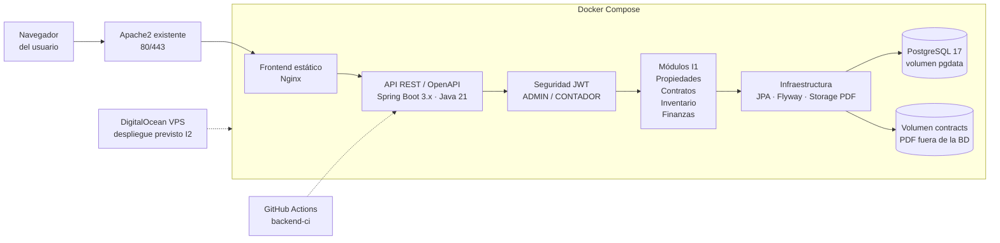

# Diagrama de la arquitectura inicial

La versión editable en Mermaid está en este archivo; la imagen PNG/SVG equivalente se publica como `docs/diagrama-arquitectura.svg`.

Notas:

- Apache2 ya ocupa los puertos 80 y 443; no se modifica en la Actividad 1.
- El backend se expone temporalmente en el puerto 8080 dentro de la red de Docker.
- Los contratos y comprobantes PDF se guardan en un volumen persistente, nunca en PostgreSQL.
- GitHub Actions ejecuta `backend-ci` antes de fusionar cambios en `main`.
