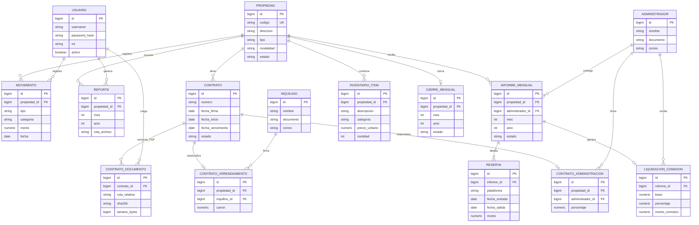

# Diagrama entidad-relación

La imagen equivalente está en `docs/diagrama-mer.svg`.

Notas:

- `CONTRATO` es la supertipo; `CONTRATO_ARRENDAMIENTO` y `CONTRATO_ADMINISTRACION` son especializaciones excluyentes.
- Los importes son `NUMERIC(14,2)`.
- Los contratos PDF no se guardan en PostgreSQL: se registra `ruta_relativa` y `sha256` en `CONTRATO_DOCUMENTO`.
- El cierre mensual bloquea movimientos e informes del mismo periodo por regla de negocio.
