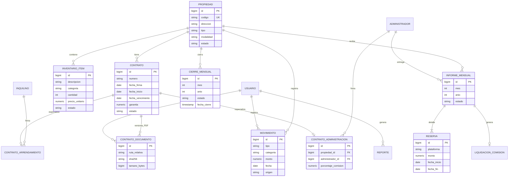

# Modelo conceptual de base de datos

## Reglas de integridad

- `UNIQUE(propiedad_id, mes, anio)` en `CIERRE_MENSUAL` e `INFORME_MENSUAL`.
- `CHECK (porcentaje_comision IN (20,25,30))` según el caso de estudio.
- `fecha_inicio <= fecha_vencimiento`.
- Foreign keys financieras con `ON DELETE RESTRICT`.
- Importes en `NUMERIC(14,2)`; nunca binarios PDF dentro de PostgreSQL.
- Valor activo de inventario = `SUM(precio_unitario * cantidad)` excluyendo `DAÑADO` y `DADO_DE_BAJA`.
- El cierre de mes bloquea cambios de movimientos e informes del mismo periodo.

## Puntos pendientes de validación con el cliente

1. Base exacta para calcular la comisión de 20 %, 25 % o 30 %.
2. Regla para cambiar una propiedad de renta tradicional a temporal.
3. Tratamiento contable de un ítem dañado y su reposición.
4. Días de anticipación para alertas de vencimiento.
5. Responsable autorizado para el cierre de mes.
